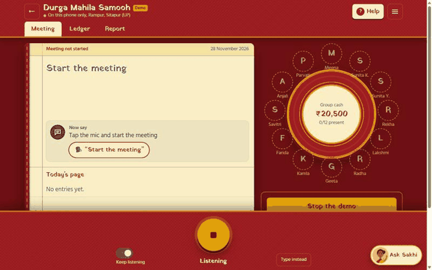
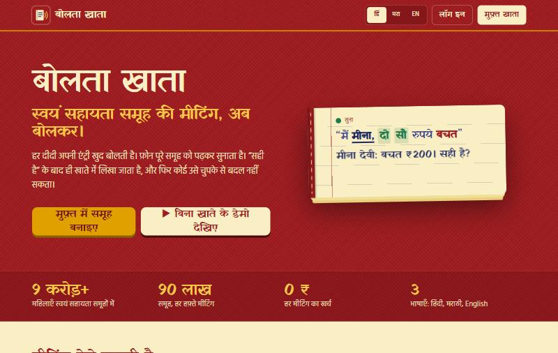
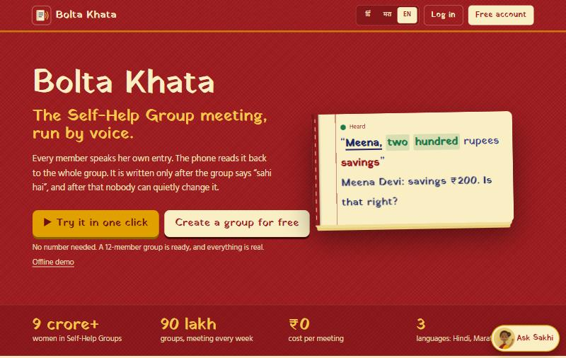
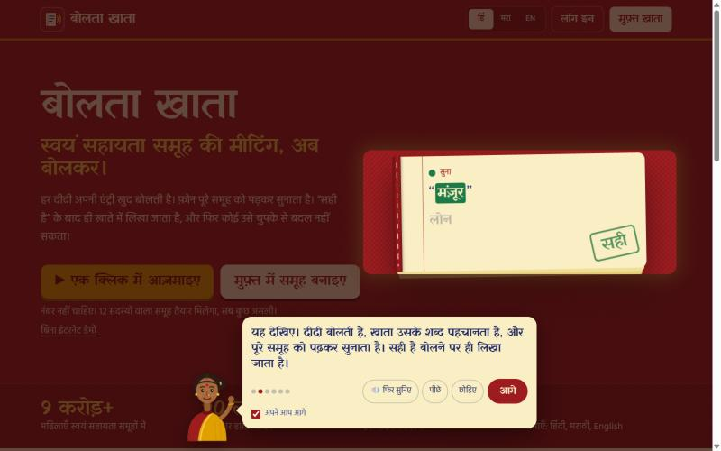
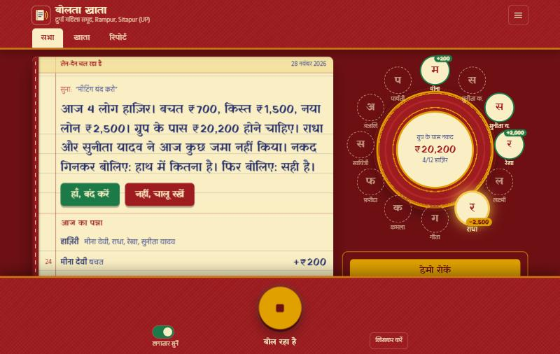
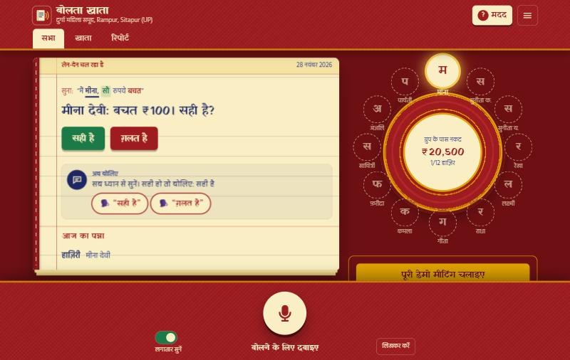
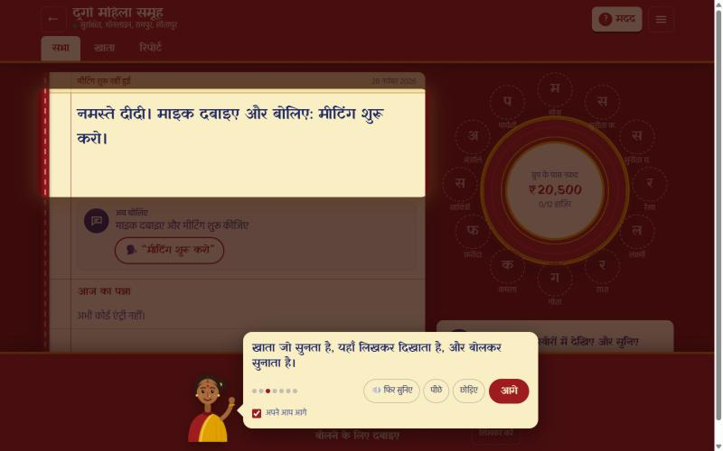
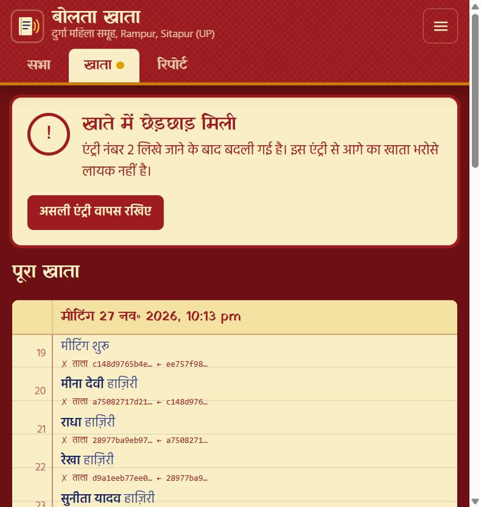
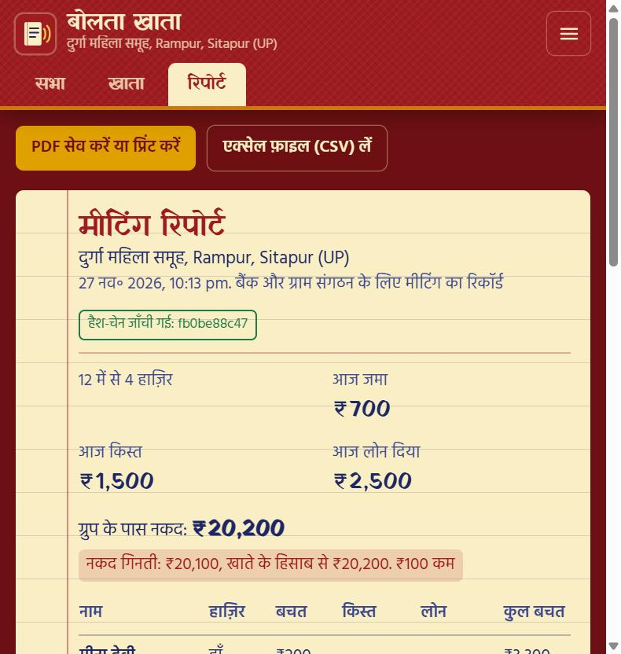
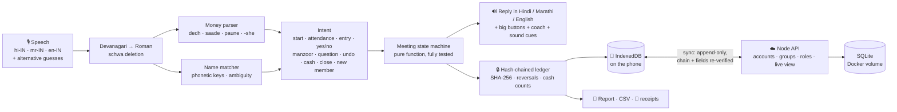

<div align="center">

# बोलता खाता · Bolta Khata

### The Self-Help Group meeting, run by voice.
**Every member speaks her own entry. The phone reads it back to the whole group. Nothing is written until the group says *"sahi hai"*, and after that nobody can quietly change it.**


*India Runs on Voice* (Scaler × Wispr Flow) · Theme: **Livelihoods and small business**



<sub>A whole meeting playing by itself (built-in demo, English). Hindi and Marathi work the same way; the screenshots below are mostly Hindi, the product's first language.</sub>

</div>

---

## Contents
[60-second review](#for-reviewers-the-60-second-path) · [Rules checklist](#submission-rules-checklist) · [Pain point](#the-pain-point-being-solved) · [Impact](#impact-in-real-world-india) · [Scorecard](#how-it-meets-each-judging-criterion) · [A meeting, spoken](#a-real-meeting-spoken) · [Screens](#screens) · [Proof it works](#proof-it-works-stress-tested-not-demo-tested) · [How it works](#how-it-works) · [Security](#security-and-privacy) · [Dependencies](#what-it-depends-on-and-what-happens-if-it-gets-costly-or-stops) · [Limits](#honest-limitations) · [Run without Docker](#run-without-docker)

---

## For reviewers: the 60-second path

```bash
docker compose up --build
```

1. Open **http://localhost:3000** in **Chrome or Edge** and allow the microphone.
2. **Sakhi Didi**, an animated guide, greets you and walks through the page aloud. Choose **EN** (top right) for English.
3. Press **▶ Try it in one click** (*एक क्लिक में आज़माइए*). No number, no form: a guest account and a saved group of 12 members with 14 months of history are created on the server, and the meeting opens with Sakhi's tour.
4. Press the mic once and say **"meeting shuru karo"**, then **"main Meena hoon"**, **"haazri poori"**, **"main Meena, sau rupaye bachat"**, **"sahi hai"**. Every step also has a tap-to-say button under *Now say*, so it works without a mic too.
5. Open the **Ledger** tab, or watch a whole meeting play itself in the offline demo (website → *Offline demo* → *Play a full demo meeting*), where **Try tampering** turns the ledger red at the exact entry changed.

**Two-screen live demo:** in the group's ☰ menu, copy the 6-letter code. In a second browser, sign up, choose *Follow a group with a code*, and open it: it shows **LIVE**, and every entry made on the first screen appears within seconds, coins flying into the pot.

---

## Submission rules checklist

| Rule | Status |
|---|---|
| Public GitHub project | ✅ |
| `docker-compose.yml` starts the app with one command | ✅ `docker compose up --build` |
| App on a port in `docker-compose.yml`, showing the app (not a default page) | ✅ `3000:3000`, serves the website and the app |
| Starts and shows its main screen **without any secret keys** | ✅ no keys exist anywhere in the project |
| `.env.example` if environment variables are used; starts without `.env` | ✅ every variable is optional with a default ([`.env.example`](.env.example)) |
| Own code written during the hackathon (about 300+ lines) | ✅ **6,826 lines** of app and server code plus **992 lines of tests**, in **62 commits** from 27 to 28 Nov 2026 |
| Demo video ≤ 3 min, pitch deck PDF | ✅ [`docs/Bolta-Khata-Pitch-Deck.pdf`](docs/Bolta-Khata-Pitch-Deck.pdf), video script in [`docs/DEMO_SCRIPT.md`](docs/DEMO_SCRIPT.md), form text in [`docs/SUBMISSION.md`](docs/SUBMISSION.md) |
| Main task done by speaking | ✅ the whole meeting (attendance, money, questions, loans, corrections, cash count, closing) runs by voice |

---

## The pain point being solved

Over **9 crore** rural women in India save and borrow through about **90 lakh Self-Help Groups (SHGs)**. Every week, 10 to 15 members sit together and hand over money, and **one member writes it into a paper register that often only she can read**.

- Members **cannot check** what was written against their own name.
- Mistakes and misuse surface **months later**, as fights or missing money.
- When the bookkeeper is absent or leaves, the **records stop**.
- **Cash in the box rarely matches the register**, and audits catch it late.
- Banks want clean books before lending, so a messy register **costs the whole group credit**.
- Today's apps (such as the government's LokOS) are typed by the bookkeeper, so **the same one woman stays in control**.

The meeting already happens out loud. **Bolta Khata makes the record happen out loud too.**

## Impact in real-world India

| Who | What changes |
|---|---|
| **SHG members** (9 crore+) | Each woman hears her own entry read back before it is saved, and can ask *"mera kitna jama hai?"* at any meeting. Trust no longer depends on one person's handwriting. |
| **Group leaders and bookkeepers** | No writing the register twice, no carrying it alone; the meeting summary, bank report and every member's receipt are produced automatically. |
| **NGO workers and CRPs** | Follow every group they support with a 6-letter code, live, on one dashboard: cash, savings, loans out, last meeting, and whether the ledger is intact. |
| **Banks and federations** | Records that cannot be quietly changed, with the cash count checked at every meeting: cleaner books before a loan. |

**How we would measure it** (pilot: 30 groups, 2 districts, 3 months alongside the paper register): 80% of members can state their own balance without help; under 2% mismatch with the paper register; a 15-member meeting recorded in under 30 minutes; 70% of groups still using it by choice after three months.

---

## How it meets each judging criterion

### Voice-first experience (30%)
- **The whole meeting runs by voice**, hands-free: tap once and it listens, answers, and listens again. [`useBoltaKhata.ts`](src/useBoltaKhata.ts)
- **Voice is the safety mechanism**, not just input: every entry is read back to the group and saved only after *"sahi hai"*; large amounts are confirmed twice; only the leader's *"manzoor"* releases a loan. [`meeting.ts`](src/lib/meeting.ts)
- **The speaker's own words light up** as they are understood: name underlined, amount in green, *bachat/kist/loan* in red. [`Understood.tsx`](src/components/Understood.tsx)
- **Clear voice:** picks the most natural voice on the device (Edge's neural Hindi voices, Google हिन्दी), speaks one sentence at a time, with a per-phone voice and speed choice. [`speech.ts`](src/lib/speech.ts)
- **Nobody needs training:** a coach under every reply says the exact words to say next (a test proves every suggested phrase is understood in its state), help cards read themselves aloud, and **Sakhi Didi** tours each screen by voice. [`coach.ts`](src/lib/coach.ts) · [`Tour.tsx`](src/components/Tour.tsx)

### India relevance (25%)
- **Money as villages say it:** *dedh hazaar, dhai sau, saade teen hazaar, paune do hazaar, sava sau*, all 99 irregular Hindi numbers, Marathi *पाचशे / दीड हजार / शंभर*, Indian digit grouping. Tested on **91,000 spoken amounts**. [`numbers.ts`](src/lib/numbers.ts)
- **Indian names as recognisers hear them:** Sunita = Suneeta = Sunitha = सुनीता; Marathi case endings (*राधाला*); two Sunitas → it asks which. [`phonetic.ts`](src/lib/phonetic.ts)
- **Devanagari and Hinglish in one sentence**, including Hindi schwa deletion (*कितना → kitnaa*). [`translit.ts`](src/lib/translit.ts)
- **Fits how SHGs actually work:** weekly meeting flow, leader approval for loans, overpaid loans closed with the rest moved to savings, the **cash box counted by voice** and checked against the khata, bank-ready report and WhatsApp receipts.
- **Hindi first**, with Marathi and English, everywhere: speech, screens, website, receipts.

### Working product (25%)
- **A full product, not a mock-up:** website, mobile + PIN accounts, a groups dashboard, roles with join codes, offline-first cloud sync, guest trials. All in one container.
- **158 automated tests**, including whole spoken meetings in three languages, 600 random noisy meetings, and API tests over real HTTP. [Proof below](#proof-it-works-stress-tested-not-demo-tested).
- **Works without network:** the ledger lives on the phone (IndexedDB) and syncs when signal returns; installable as an app (PWA).
- **Every spoken question also has a big button**, for noisy rooms and for judges without a mic.

### Originality (20%)
- **A register nobody can quietly edit:** every entry stores the SHA-256 of the one before it, and **the server re-verifies the chain on every sync**, refusing an edited entry even from the owner. [`ledger.ts`](src/lib/ledger.ts) · [`server/app.ts`](server/app.ts)
- **The group hears every entry before it exists**: group read-back as the confirmation step, which a typing app cannot do.
- **The meeting as it looks:** members seated in a circle on a durrie, coins flying from a member's seat into the group pot, a stitched cloth register, a green *सही* stamp, marigold petals when the meeting closes.
- **Sakhi Didi**, an original illustrated guide who speaks, blinks and waves while spotlighting each part of the screen.

---

## A real meeting, spoken

```
 👩 Leader   मीटिंग शुरू करो
 📒 Khata    मीटिंग शुरू। हाज़िरी के लिए सब अपना नाम बोलिए।
 👩 Meena    मैं मीना हूँ                              → 🟢 Meena's seat fills in
 👩 …        सुनीता
 📒 Khata    सुनीता कुमारी या सुनीता यादव?            ← two Sunitas: it asks, never guesses
 👩 Meena    मैं मीना, दो सौ रुपये बचत
 📒 Khata    मीना देवी: बचत ₹200। सही है?             ← read back to the whole group
 👥 Group    हाँ सही है                                → 🟩 सही stamp, 🪙 coins fly into the pot, 🔒 hash-locked
 👩 Rekha    रेखा की किस्त दो हज़ार
 📒 Khata    किस्त ₹1,500, बचत ₹500 …                 ← only ₹1,500 was owed: loan closed, rest to savings
 👩 Leader   राधा को ढाई हज़ार लोन
 📒 Khata    ग्रुप के पास ₹22,700 से ₹20,200 बचेंगे। नेता जी, मंज़ूर?
 👩 Leader   मंज़ूर                                    ← only the leader's word releases a loan
 👩 Radha    मेरा कितना जमा है?
 📒 Khata    राधा, आपकी कुल बचत ₹3,000। बाकी लोन ₹5,500।
 👩 Leader   मीटिंग बंद करो  …  हाथ में बीस हज़ार एक सौ है
 📒 Khata    खाते के हिसाब से ₹20,200 होने चाहिए। ₹100 कम है। यह गिनती खाते में दर्ज हो गई।
 👥 Group    सही है                                    → 🌼 petals · 📄 bank report · 🧾 a receipt for every member
```

This exact meeting is the built-in demo, and it runs through the real engine in the test suite **in Hindi, Marathi and English**.

---

## Screens

<table>
<tr>
<td width="50%"></td>
<td width="50%"></td>
</tr>
<tr><td align="center"><b>Website in Hindi</b> (default)</td><td align="center">The <b>same site in English</b>, one tap away (Marathi too)</td></tr>
<tr>
<td></td>
<td></td>
</tr>
<tr><td align="center"><b>Sakhi Didi</b> walks through the site aloud</td><td align="center">The <b>meeting</b>: register page and the circle of members</td></tr>
<tr>
<td></td>
<td></td>
</tr>
<tr><td align="center"><b>Read-back</b> and the <b>next-step coach</b></td><td align="center">Sakhi's <b>meeting tour</b> after one click</td></tr>
<tr>
<td></td>
<td></td>
</tr>
<tr><td align="center"><b>Tamper-proof ledger</b>: one changed rupee turns it red</td><td align="center"><b>Bank report</b> with the cash count</td></tr>
<tr>
<td></td>
<td></td>
</tr>
<tr><td align="center"><b>Dashboard</b> of every group you run or follow</td><td align="center"><b>Help that talks</b>, and what you have learned</td></tr>
</table>

---

## Proof it works: stress-tested, not demo-tested

```
 158 tests · all passing · npm test
 ├─ 91,000  spoken Hindi amounts (10 → 99,999) parsed back exactly
 ├─  2,000  random amounts × 3 formats (₹, rs, Indian digit grouping)
 ├─    600  seeded random meetings × 45 noisy utterances each
 │          (Hinglish, Devanagari, half-sentences, silence, gibberish,
 │           new members, cash counts, "which Sunita?")
 │          invariants: hash chain valid · cash never negative · loans never below zero ·
 │          no money written without a "yes" · no member added twice
 ├─      3  full demo meetings (Hindi, Marathi, English) through the real engine
 ├─      3  coach walks: every suggested phrase, in every state, in every language
 ├─     12  API tests over real HTTP: sign-up, PIN lockout, guest trial and claim, groups,
 │          sync, tampered or nonsensical entries refused, stale copies refused,
 │          read-only followers, JSON-only writes, safe headers
 └─     …   phone ↔ server merge, voice ranking, every on-screen example in every language
```

**Bugs the stress tests found, all fixed and now guarded by tests:**

| Found | Fix |
|---|---|
| *tees* (30) was saved as ₹23 | Number table cleaned; a test fails if any spoken word maps to two numbers |
| *पचहत्तर* (75) not understood | Schwa deletion before another schwa |
| An overpaid loan went below zero | Loan closes, the extra goes to savings |
| No answer to "मंज़ूर?" froze the meeting | An unapproved loan lapses when the group moves on |
| "Which Sunita?" could ask forever | Stops asking when the group moves on |
| After "naya sadasya", *"Rekha 500 bachat"* became a member | Only a real name is accepted |
| *Suman Sharma* and *सुमन शर्मा* became two members | Duplicates matched across scripts |
| Two quick taps could overwrite each other's entry | Conversation turns are queued |
| A view-only follower's phone could record entries locally | Writes blocked for followers, role remembered offline |

---

## How it works



The heart is `step(state, heard, ledger) → (state, reply, entries)`: a pure function with no timers, audio or storage, which is why a whole meeting can be replayed in a test. Understanding is **rule-based on purpose**: it runs offline, in milliseconds, costs nothing, and never invents an amount.

| Path | What it does |
|---|---|
| [`src/lib/numbers.ts`](src/lib/numbers.ts) · [`translit.ts`](src/lib/translit.ts) · [`phonetic.ts`](src/lib/phonetic.ts) | Spoken money, Devanagari, Indian names |
| [`src/lib/intent.ts`](src/lib/intent.ts) · [`meeting.ts`](src/lib/meeting.ts) | What a sentence means; the meeting as a state machine |
| [`src/lib/ledger.ts`](src/lib/ledger.ts) · [`sync.ts`](src/lib/sync.ts) | Hash chain, balances, reversals; phone ↔ server merge |
| [`src/lib/speech.ts`](src/lib/speech.ts) · [`phrases.ts`](src/lib/phrases.ts) · [`coach.ts`](src/lib/coach.ts) | Listening and speaking; every reply in 3 languages; next-step coach |
| [`src/useBoltaKhata.ts`](src/useBoltaKhata.ts) | Hands-free loop, queued turns, demo player, cloud sync, live view |
| [`src/pages/`](src/pages) · [`src/screens/`](src/screens) · [`src/components/`](src/components) | Website, sign-in, dashboard; meeting, ledger, report; Sakhi, circle, coach |
| [`server/`](server) | API, auth, SQLite schema: Node built-ins only |

---

## Security and privacy

- **PINs** are stored only as scrypt hashes; **sessions** are random tokens stored only as SHA-256 hashes, in `HttpOnly`, `SameSite=Lax` cookies.
- **Five wrong PINs** lock a number for ten minutes; sign-ups and guest trials are rate-limited per address.
- **Write routes accept only JSON**; every synced entry is checked field by field (known type, amount between ₹0 and ₹1 crore, real hashes) **and** against the hash chain.
- **Followers are read-only** on the server and on their phone.
- The **offline demo never leaves the phone**; groups in an account are saved to the server you run. Guest trials are deleted after 3 days unless claimed.

## What it depends on, and what happens if it gets costly or stops

| Dependency | Used for | If it gets costly or stops working |
|---|---|---|
| Browser speech recognition (Chrome, Edge, Android) | Speech → text | Free today, needs internet. The engine only needs text, so an on-device model or an Indian speech API (Bhashini, Sarvam) can be dropped in behind `listen()`. Typing and buttons always work offline. |
| Browser speech synthesis | Speaking replies | Free and on-device. Without a Marathi voice it uses the Hindi voice and still shows the text. |
| Our own Node server + SQLite | Accounts, groups, cloud copy, live view | Built-in modules only, one container. If it is down, meetings carry on offline and sync later. |
| **Nothing paid** | | **No AI API, no paid speech, no external database: ₹0 per meeting.** |

## Honest limitations

- Speech recognition quality depends on the browser and the room; that is why every entry is read back and confirmed, and every question has a button.
- Browser recognition needs internet; the rest of the app does not.
- A view-only follower sees updates by polling every few seconds, not instant push.
- If two phones write to the same group while offline, the server's copy is kept and the other phone is told; real groups use one leader's phone.

## Run without Docker

```bash
npm install
npm run dev:api   # API + SQLite on :8787 (Node 22.18+ runs the TypeScript directly)
npm run dev       # website on http://localhost:3000, /api proxied to :8787
npm test          # 158 tests
```

Production without Docker: `npm run build && npm start` serves everything on port 3000. All settings in [`.env.example`](.env.example) are optional.

## Built by voice with Wispr Flow

Every instruction, feature idea and bug report for this build was spoken to an AI coding assistant through Wispr Flow, in Hinglish. Sakhi Didi, the clearer voice, the redesigned sign-up form and the stress tests that found nine bugs all started as spoken requests. Speaking everything out loud meant describing the product the way an SHG member experiences it, and switching between Hindi and English mid-sentence, exactly what Bolta Khata has to handle. The full note is in [`docs/SUBMISSION.md`](docs/SUBMISSION.md).

## Roadmap for the finale

- On-device speech recognition for full offline use, and Bhashini for more Indian languages
- Missed-call / IVR mode so members with feature phones hear their own balance
- Speaker check on loan approval, so only the leader's own voice can say *manzoor*
- Encrypted backup and LokOS-format export

## License

MIT
