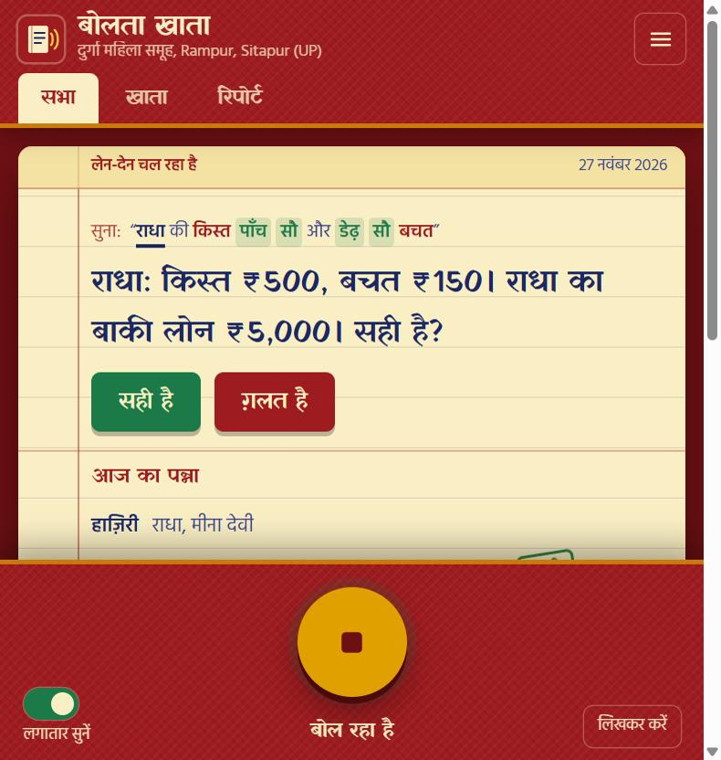
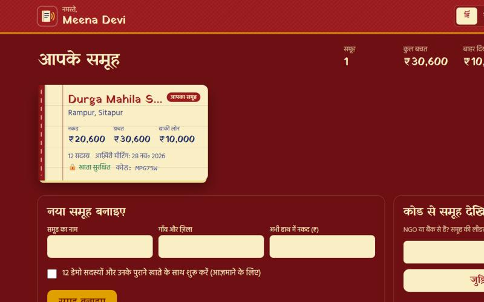
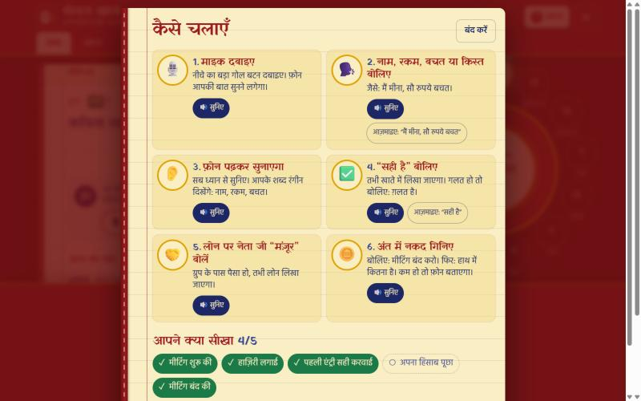
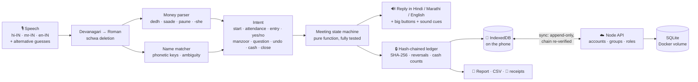

<div align="center">

# बोलता खाता · Bolta Khata

### The Self-Help Group register that listens, reads back, and cannot be quietly changed.

*Ten women sit on a durrie. Money changes hands. One of them writes it down.*
*Now every one of them can hear it.*


**India Runs on Voice** hackathon (Scaler × Wispr Flow) · Theme: *Livelihoods and small business*

</div>

<p align="center"></p>

<table>
<tr>
<td width="33%"></td>
<td width="33%"></td>
<td width="33%"></td>
</tr>
<tr>
<td align="center"><b>Speak.</b> Your words light up as they are understood. It reads back. The group says <i>sahi hai</i>.</td>
<td align="center"><b>Tamper?</b> Change one old rupee and the ledger turns red at exactly that entry.</td>
<td align="center"><b>Close.</b> Count the cash box by voice. ₹100 short? It is said out loud and locked in.</td>
</tr>
</table>

## A real product: website, accounts, dashboard, cloud

<table>
<tr>
<td width="55%"></td>
<td width="45%"></td>
</tr>
<tr>
<td align="center"><b>Website</b> in Hindi, Marathi and English, with a meeting playing live in the hero.</td>
<td align="center"><b>Dashboard</b> of every group you run or follow, with live figures.</td>
</tr>
</table>

| | |
|---|---|
| **Accounts** | Mobile number + 4–6 digit PIN, like UPI. PINs stored only as scrypt hashes; sessions are random tokens kept only as hashes, in HttpOnly cookies; five wrong PINs lock the number for ten minutes. |
| **Many groups** | One person can run several groups. Create one empty (with the cash carried over) or pre-filled with demo members to try it. |
| **Roles** | The leader's phone writes. A six-letter **join code** lets an NGO worker, CRP or bank officer **follow** a group read-only and see all their groups on one dashboard. |
| **Offline-first sync** | Each group's khata lives on the phone and works without signal; new entries go to the server a moment after they are written and again when the network returns. If two phones ever split, the server's copy is kept and the phone is told. |
| **Tamper-proof on the server too** | The server stores the ledger append-only and re-verifies the SHA-256 chain on every sync. It refuses a quietly edited entry, even from the owner. |
| **One container** | Website + API + SQLite in one Node process using only built-in modules. Data lives on a Docker volume. No keys, no external database. |

## Anyone can use it, without being taught

<table>
<tr>
<td width="50%"></td>
<td width="50%"></td>
</tr>
<tr>
<td align="center"><b>A coach under every reply.</b> One plain line: what to do now, and the exact words to say, as big buttons. Nobody has to remember anything.</td>
<td align="center"><b>Help that talks.</b> Six picture cards, each read aloud with 🔊, each with a phrase to try. A ladder ticks off what your group has already done.</td>
</tr>
</table>

A test walks real meetings in all three languages and **tries every phrase the coach can ever suggest, in the state it suggests it**, so the coach can never tell a group to say something the app will not understand.

---

## Try it in 30 seconds

```bash
docker compose up --build
```

Open **http://localhost:3000** in Chrome. You land on the website. Then either:

- ▶️ **बिना खाते के डेमो देखिए** (*Watch the demo, no account*): the meeting app with a demo group, where **पूरी डेमो मीटिंग चलाइए** plays a whole meeting by itself, or
- **मुफ़्त खाता** (*Free account*): sign up with any 10-digit mobile number and a PIN, create a group (tick *start with 12 demo members* to try it), and run a meeting by voice. It saves to the server as you go.

The first screen asks for a language (**हिंदी · मराठी · English**), explains the idea in three lines, and offers the demo or your own meeting. On a laptop, **Space** talks and **Esc** stops.

No keys. No `.env`. No sign-up. No server.

**Your own group:** ☰ menu → *अपना समूह शुरू करें* (Start your own group): type the group name and the cash carried over, then add members by voice: *"नया सदस्य जोड़ो: पुष्पा देवी"*.

<details>
<summary>Without Docker</summary>

```bash
npm install
npm run dev:api   # API + SQLite on :8787 (Node 22.18+ runs the TypeScript directly)
npm run dev       # website on http://localhost:3000, /api proxied to :8787
npm test          # 152 tests
```

Production without Docker: `npm run build && npm start` serves everything on port 3000. Optional settings are in `.env.example`; none are required.
</details>

---

## The problem

Over **9 crore** rural women in India save and borrow through about **90 lakh** Self-Help Groups. Every week, 10 to 15 members meet and hand over money, and **one member writes it into a paper register that often only she can read.**

| What happens today | What it costs |
|---|---|
| Members cannot check what was written against their name | Mistakes and misuse stay hidden for months |
| The register is a private notebook | Arguments over "who paid what" break groups apart |
| The bookkeeper is absent or leaves | Records simply stop |
| Messy books | Banks hesitate to lend, so the whole group loses credit |
| Apps like LokOS are typed by the bookkeeper | The same one woman is still in control |

**The meeting already happens out loud. Bolta Khata makes the record happen out loud too.**

---

## A meeting, start to finish

```
 👩 Leader   मीटिंग शुरू करो
 📒 Khata    मीटिंग शुरू। हाज़िरी के लिए सब अपना नाम बोलिए।
 👩 Meena    मैं मीना हूँ                              → 🟢 Meena present
 👩 ...      सुनीता
 📒 Khata    सुनीता कुमारी या सुनीता यादव?            ← two Sunitas: it asks, never guesses
 👩 Sunita   यादव
 👩 Meena    मैं मीना, दो सौ रुपये बचत
 📒 Khata    मीना देवी: बचत ₹200। सही है?             ← read back to the whole group
 👥 Group    हाँ सही है                                → 🟩 सही  (stamped, hash-locked)
 👩 Rekha    रेखा की किस्त दो हज़ार
 📒 Khata    किस्त ₹1,500, बचत ₹500 …                 ← only ₹1,500 was owed: loan closed, rest to savings
 👩 Leader   राधा को ढाई हज़ार लोन
 📒 Khata    ग्रुप के पास ₹22,700 से ₹20,200 बचेंगे। नेता जी, मंज़ूर?
 👩 Leader   मंज़ूर                                    ← only the leader's word releases a loan
 👩 Radha    मेरा कितना जमा है?
 📒 Khata    राधा, आपकी कुल बचत ₹3,000। बाकी लोन ₹5,500।
 👩 Leader   मीटिंग बंद करो
 📒 Khata    आज 4 लोग हाज़िर। बचत ₹700, किस्त ₹1,500, नया लोन ₹2,500 … नकद गिनकर बोलिए।
 👩 Leader   हाथ में बीस हज़ार एक सौ है
 📒 Khata    पर खाते के हिसाब से ₹20,200 होने चाहिए। ₹100 कम है। यह गिनती खाते में दर्ज हो गई।
 👥 Group    सही है                                    → 📄 bank report + 🧾 a receipt for every member
```

This exact meeting is the built-in demo, and it runs through the real engine in the test suite in **all three languages**.

---

## Why it is not "a form with a mic"

### 🗣️ 1. Voice is the safety mechanism, not the input method
Nothing is written until the group hears it and says *"sahi hai"*. Large amounts are read back **twice**. A loan needs the leader's *"manzoor"* **and** enough cash in the box. Corrections are new entries, never edits. Every spoken question also has a big button for noisy rooms.

### 🔢 2. It understands money the way villages say it
A hand-written parser, so it **never invents an amount** (no LLM guessing at rupees):

| Said | Understood |
|---|---|
| *dedh hazaar*, डेढ़ हज़ार, दीड हजार | ₹1,500 |
| *saade teen hazaar* | ₹3,500 |
| *paune do hazaar* | ₹1,750 |
| *sava sau*, *dhai sau*, अडीच हजार | ₹125, ₹250, ₹2,500 |
| *ek hazaar do sau pachaas* | ₹1,250 |
| पाचशे, दोनशे (Marathi) | ₹500, ₹200 |
| *pachchis hazaar*, पचहत्तर | ₹25,000, ₹75 |
| *two thousand five hundred*, ₹1,25,000, *2k* | as said |
| "Sunita ko do hazaar **do**" | ₹2,000 (the last *do* means "give") |
| "राधा **हजर**" (Marathi: present) | not ₹1,000 |

All 99 irregular Hindi numbers, Marathi forms, English words, Devanagari digits, Indian digit grouping. **Stress-tested on 91,000 spoken amounts from 10 to 99,999.**

### 👂 3. It hears Indian names the way recognisers mishear them
*Sunita, Suneeta, Sunitha* and *सुनीता* reach the same member. *Laxmi = Lakshmi.* Marathi case endings (*राधाला*) are stripped. Hindi schwa deletion (*कितना → kitnaa*) is handled. And when two members sound alike, it **asks instead of guessing**.

### 🎨 4. You can *see* it understand
As she speaks, her own words light up: the **name** underlined, the **amount** in green, **bachat / kist / loan** in red, **sahi / galat** stamped. The group sees it understood before it even answers.

### 🔒 5. A register nobody can quietly edit
Every entry stores the SHA-256 of the entry before it. Press **"छेड़छाड़ करके देखिए"** (*Try tampering*) on the Ledger screen: it secretly takes ₹1,000 off an old entry, and the ledger turns red **at exactly that entry**. Receipts carry the lock code, so a member can prove which version of the khata her receipt came from.

### 💰 6. The cash box is counted by voice
The step where SHG money really goes missing is the end-of-meeting cash count. Say *"हाथ में 20,100 है"* and it checks against what the khata says the group should hold, announces any shortfall, and **locks the count into the chain**. The bank report shows it.

### 🪔 7. It looks like the meeting it serves
The members sit in a **circle around a durrie**, the way an SHG actually meets. Present members fill their seat, absent ones stay dashed, the woman whose money is on the table **glows**, today's deposits and loans appear as **coins on her seat**, and the group's cash sits in the middle. The register has a **stitched cloth binding**, lines are **written in like ink**, a new meeting **turns a fresh page**, and the green *सही* stamp lands with a **thump**.

### ✨ 8. Money you can see move
When a member saves, **three gold coins fly from her seat into the group pot** and the pot glows; a loan sends them **out of the pot to her seat**. Closing a meeting or welcoming a new member brings a **shower of marigold (genda) petals**. Each reply **appears word by word** as it is spoken, so slower readers can follow the voice. All of it switches off for people who prefer reduced motion.

### 👥 9. A real group, set up by voice
Start your own group, then *"नया सदस्य जोड़ो: पुष्पा देवी"*. The name is read back and added only on *"सही है"*, duplicates are refused even across scripts (*Suman Sharma* = *सुमन शर्मा*), and every joining is locked into the chain.

### 🌳 10. Built for a meeting under a tree
- **Hands-free**: tap once; it listens, answers and listens again for the whole meeting.
- **Offline-first**: installable PWA; the ledger lives on the phone (IndexedDB) and works with no signal. The demo never leaves the phone; a signed-in group is also saved to the server.
- **Three languages**, and Hindi/Marathi spoken in Devanagari by the phone's own voice.
- **Live mic-level ring**, so speakers can see they are being heard.

### 🏦 11. Output a bank will accept
Meeting report (print / save as PDF), CSV for the federation or bank, and a receipt per member that can be **read aloud in her language** or **sent on WhatsApp**.

---

## Stress-tested, not demo-tested

```
 152 tests · all passing
 ├─ 91,000  spoken Hindi amounts (10 → 99,999) parsed back exactly
 ├─  2,000  random amounts × 3 formats (₹, rs, Indian digit grouping)
 ├─    600  seeded random meetings × 45 noisy utterances each
 │          (Hinglish, Devanagari, half-sentences, silence, gibberish,
 │           new members, cash counts, "which Sunita?")
 │          invariants: hash chain valid · cash never negative ·
 │          loans never below zero · no money written without a "yes" ·
 │          no member ever added twice
 ├─      3  full demo meetings (Hindi, Marathi, English) through the real engine
 ├─      3  coach walks: every suggested phrase, in every state, in every language
 ├─      7  API tests over real HTTP: sign-up, PIN lockout, groups, sync,
 │          tampered entry refused, stale copy refused, read-only followers
 ├─      4  phone ↔ server merge cases
 └─     ...  every example sentence shown on screen, in every language
```

The stress tests found **eight real bugs**, all fixed and now guarded by tests:

| Found by the stress test | Fix |
|---|---|
| *tees* (30) was saved as ₹23 | Number table cleaned; a test fails if any spoken word ever maps to two numbers |
| *पचहत्तर* (75) was not understood | Schwa deletion before another schwa |
| An overpaid loan went below zero | Loan closes, the extra goes to her savings |
| No answer to "मंज़ूर?" froze the meeting | An unapproved loan lapses when the group moves on |
| "Which Sunita?" could ask forever | Stops asking when the group moves on |
| After "naya sadasya", *"Rekha 500 bachat"* became a member | Only a real name is accepted |
| *Suman Sharma* and *सुमन शर्मा* became two members | Duplicates are matched across scripts |
| Two quick taps could overwrite each other's entry | Conversation turns are queued |

---

## How it works



The heart is `step(state, heard, ledger) → (state, reply, entries)`: a pure function with no timers, audio or storage, which is why a whole meeting can be replayed in a test.

| File | What it does |
|---|---|
| [`src/lib/translit.ts`](src/lib/translit.ts) | Devanagari → Roman, with Hindi schwa deletion |
| [`src/lib/numbers.ts`](src/lib/numbers.ts) | Spoken money parser |
| [`src/lib/phonetic.ts`](src/lib/phonetic.ts) | Indian name matching and "which one?" detection |
| [`src/lib/intent.ts`](src/lib/intent.ts) | What a sentence means, and which words meant it |
| [`src/lib/meeting.ts`](src/lib/meeting.ts) | The meeting as a state machine |
| [`src/lib/ledger.ts`](src/lib/ledger.ts) | Hash chain, reversals, balances |
| [`src/lib/phrases.ts`](src/lib/phrases.ts) | Everything it says, in three languages, plus the demo scripts |
| [`src/lib/speech.ts`](src/lib/speech.ts) | Listening, speaking, sound cues, mic level |
| [`src/useBoltaKhata.ts`](src/useBoltaKhata.ts) | Hands-free loop, queued turns, demo player, cloud sync |
| [`src/lib/sync.ts`](src/lib/sync.ts) | Merging the phone's and the server's copy of a khata |
| [`server/app.ts`](server/app.ts) | The API: accounts, groups, join codes, append-only sync with chain checks |
| [`server/auth.ts`](server/auth.ts) | scrypt PINs, session tokens, lockout after wrong PINs |
| [`server/db.ts`](server/db.ts) | SQLite schema (Node's built-in `node:sqlite`) |
| [`src/pages/`](src/pages) | Website, sign-in and the groups dashboard |

---

## What it depends on

| Dependency | Used for | If it gets costly or stops working |
|---|---|---|
| Browser speech recognition (Chrome / Android) | Speech → text | Free today, needs internet. The engine only needs text, so an on-device model or an Indian speech API (Bhashini, Sarvam) can be dropped in behind `listen()`. Typing and buttons always work offline. |
| Browser speech synthesis | Speaking replies | Free, on-device. Missing a Marathi voice? Falls back to Hindi and still shows the text. |
| Our own Node server + SQLite | Accounts, groups, cloud copy of each khata | Built-in modules only, runs anywhere Docker runs. If it is down, meetings carry on offline and sync later. |
| **Nothing paid** | | **No AI API, no paid speech, no external database.** ₹0 per meeting. |

## Accessibility

- Every spoken question has a big button; every reply is spoken **and** shown in large text.
- Text meets WCAG AA contrast on the ledger paper; tap targets are at least 44px.
- Full keyboard use with visible focus; Space to talk, Esc to stop.
- `prefers-reduced-motion` turns off the page turn, ink and stamp animations.

## Roadmap for the finale

- Speech recognition that works fully offline (on-device model) and Bhashini for more Indian languages
- Encrypted backup and sync to the village organisation; LokOS-format export
- Missed-call / IVR mode, so members with feature phones hear their own balance
- Speaker check on loan approval, so only the leader's own voice can say *manzoor*

## Built by voice with Wispr Flow

How Wispr Flow was used to build this is described in the Round 2 submission note.

## License

MIT
